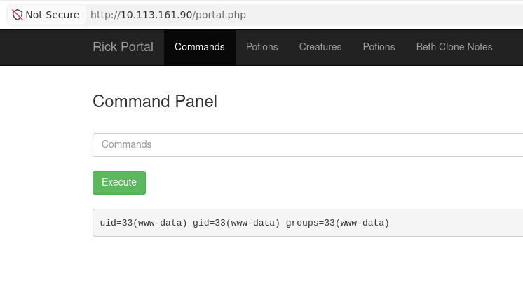

## Room Overview

| Difficulty | Platform | Room | Topics |
|------------|----------|------|--------|
| Easy | TryHackMe | [Pickle Rick](https://tryhackme.com/room/picklerick) | Command injection |


## Room description

*A Rick and Morty CTF. Help turn Rick back into a human!*

> This Rick and Morty-themed challenge requires you to exploit a web server and find three ingredients to help Rick make his potion and transform himself back into a human from a pickle.
> Deploy the lab machine on this task and explore the web application.

## Reconnaissance

An initial portscan shows:

```console
nmap -sV -sC 10.113.161.90

PORT   STATE SERVICE VERSION
22/tcp open  ssh     OpenSSH 8.2p1 Ubuntu 4ubuntu0.11 (Ubuntu Linux; protocol 2.0)
| ssh-hostkey: 
|   3072 03:65:41:7c:59:3e:64:db:7d:9a:5f:f6:54:04:28:b2 (RSA)
|   256 f0:d2:ac:78:a3:a0:43:b1:37:a9:ec:b8:63:7e:97:90 (ECDSA)
|_  256 e4:b8:97:fb:08:e1:a4:8e:72:6d:83:fe:3c:57:87:c4 (ED25519)
80/tcp open  http    Apache httpd 2.4.41 ((Ubuntu))
|_http-title: Rick is sup4r cool
|_http-server-header: Apache/2.4.41 (Ubuntu)
Service Info: OS: Linux; CPE: cpe:/o:linux:linux_kernel
```

## Enumeration

`gobuster dir -u http://10.113.161.90 -w /usr/share/dirbuster/wordlists/directory-list-2.3-medium.txt` shows us

http://10.113.161.90/assets/

where the webserver lists the folder's contents with some pictures, JavaScript and CSS files.
Visiting the website and looking at the HTML source already reveals a username in the comments:

```
<!--
    Note to self, remember username!
    Username: R1ckRul3s
-->
```

There is also a `robots.txt` file with the string `Wubbalubbadubdub` which looks like a possible password. Trying `ssh` with the found username fails because of a missing authentication:

```
R1ckRul3s@10.113.161.90: Permission denied (publickey).
```

Another `gobuster` run 

```
gobuster dir -u http://10.113.161.90 -w /usr/share/dirbuster/wordlists/directory-list-2.3-medium.txt -x php,log,conf,txt,md
```

additionally shows 

```console
login.php            (Status: 200) [Size: 882]
assets               (Status: 301) [Size: 315] [--> http://10.113.161.90/assets/]
portal.php           (Status: 302) [Size: 0] [--> /login.php]
```


## Initial Access

`login.php` is a login page, and the credentials grants access to a *Command Panel* where I apparently can execute something -- I assume that would be Linux commands.
A first shot with `id` as command shows us the user running the web service:



`ls` shows the content of the current folder (`pwd`: `/var/www/html`) with a file named `Sup3rS3cretPickl3Ingred.txt`. The server rejects execution of `cat Sup3rS3cretPickl3Ingred.txt` but allows the command `less Sup3rS3cretPickl3Ingred.txt` which gives me the first flag.

Another file, `clue.txt`, in the same folder tells to `Look around the file system for the other ingredient`.
I find `/home/rick/second ingredients` and can print the second flag via `less "/home/rick/second ingredients"`.


## Privilege Escalation

For the last flag, I assume I need to elevate my privilege. Testing `sudo -l` shows that the user `www-data` can execute arbitrary commands:

```console
Matching Defaults entries for www-data on ip-10-113-161-90:
    env_reset, mail_badpass, secure_path=/usr/local/sbin\:/usr/local/bin\:/usr/sbin\:/usr/bin\:/sbin\:/bin\:/snap/bin

User www-data may run the following commands on ip-10-113-161-90:
    (ALL) NOPASSWD: ALL
```

Executing `sudo ls -la /root/` shows a file `3rd.txt`, and using `sudo less /root/3rd.txt` shows the third flag.


## Lessons Learned

Looking at other write-ups, a nicer solution would have been to use a reverse shell which can be started via the web form's command injection.
Filesystem enumeration is then more efficient than with using the web form for each single command (where I need to consider e.g. whitespaces in filenames with quotes).
